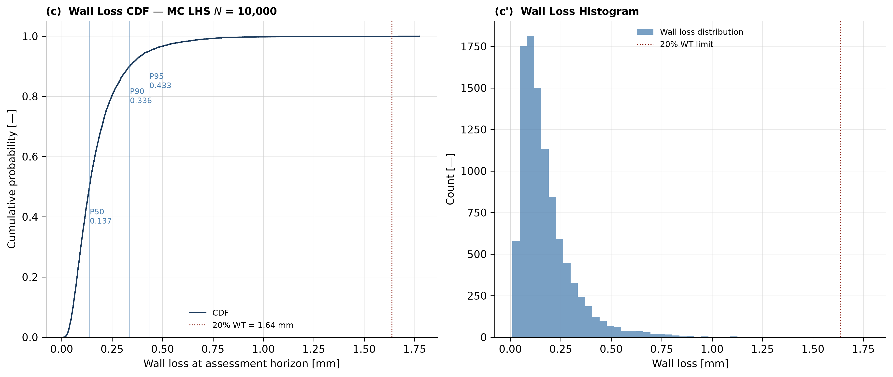

# ICS2 Week 9 — CUI Coupled Thermohygro-Electrochemical Simulation

[](https://github.com/felipearocha/integrity-code-series-week9-cui/actions/workflows/ci.yml)
[](LICENSE)
[](https://www.python.org/downloads/)
[](tests)
[](https://github.com/astral-sh/ruff)
[](https://doi.org/10.5281/zenodo.20172508)

Three-way coupled physics-first simulator for **Corrosion Under Insulation (CUI)**
on insulated carbon-steel process piping. Simulates moisture ingress through a
cladding holiday, hygrothermal transport to the hot pipe surface, and Butler-
Volmer corrosion kinetics — all solved together via Strang operator splitting.
Includes a DFOS-informed inverse problem to recover holiday source magnitude
from outer-cladding temperature observations.



*Monte Carlo wall loss at 10 years (N = 10,000, seed 42): P50 = 0.137 mm, P95 = 0.433 mm; 2 of 10,000 samples exceed the 20 % wall limit of 1.64 mm.*

## Problem Statement

CUI caused approximately 60% of all pipe leaks in a Texas refinery case study (Cuervo & McQueen,
AMPP 2022). It progresses unseen beneath insulation systems for years. PHMSA direct final rule
PHMSA-2026-1520 (April 24, 2026) clarifies integrity management guidance for hazardous liquid and
CO2 pipelines. CUI on carbon steel is commonly cited as most severe between about 50 and 175 C;
the 120 C process temperature used here sits in that range.

This package simulates three-way coupled physics: heat conduction through the insulation
annulus, hygrothermal moisture transport driven by capillary and thermal gradients, and
Butler-Volmer electrochemical corrosion at the steel surface — all solved together via
Strang operator splitting. A DFOS-informed inverse problem recovers the moisture source
magnitude from outer cladding temperature measurements.

## Results

From `python run_all.py` (seed 42). The inputs are the nominal and `[ASSUMED]` values in
`src/constants.py`, so these numbers illustrate the model and do not describe a real line.

| Output | Value |
|---|---|
| Deterministic wall loss at 10 yr | 0.1360 mm (about 0.014 mm/yr) |
| Cladding temperature at 10 yr | 58.6 C |
| Monte Carlo, N = 10,000, wall loss at 10 yr | P50 = 0.1374 mm, P95 = 0.4328 mm |
| PoF at 10 yr (wall loss above 20% of nominal wall) | 0.0002, no perforations |
| Spearman rank correlation with wall loss | $i_{0,\mathrm{ref}}$ +0.70, $E_a$ +0.69, $S_{\mathrm{mag}}$ +0.02, $\theta_{\mathrm{crit}}$ 0.00 |
| GBR surrogate | $R^2$ = 0.9370, MAE = 0.0263 mm |
| Inverse recovery of $S_{\mathrm{mag}}$, 0.03 K noise | errors of 0.2%, 0.0% and 0.9% |
| FAD, 10 yr baseline | 0 of 122 points unacceptable |

Wall loss is controlled by the two kinetic parameters. The insulation wets within about a month
in the baseline, so the moisture source hardly matters over 10 years. Figures are generated in
`assets/figures/` by `run_all.py` and attached to GitHub releases; they are not stored in the
repository.

## Governing Equations

[**view the full rendered reference**](https://htmlpreview.github.io/?https://github.com/felipearocha/integrity-code-series-week9-cui/blob/main/docs/equations.html)

Full rendered (MathJax) reference: **[docs/equations.html](docs/equations.html)** — open in any browser.

The solvers are 1D radial (axisymmetric): the axial nodes in `src/geometry.py` are built but not
used.

### Field 1 — Fourier heat conduction (Eq. 1)

```math
\rho_{\mathrm{eff}}(\theta_w)\,c_{p,\mathrm{eff}}(\theta_w)\,\frac{\partial T}{\partial t} = \nabla\cdot\bigl(\lambda_{\mathrm{eff}}(\theta_w)\,\nabla T\bigr) + Q_{\mathrm{corr}}
```

$T$ is temperature [K], $\theta_w$ the moisture volume fraction [-], $\rho_{\mathrm{eff}}$ density
[kg/m³], $c_{p,\mathrm{eff}}$ specific heat [J/kg/K], $\lambda_{\mathrm{eff}}$ conductivity [W/m/K]
and $Q_{\mathrm{corr}}$ the corrosion heat source [W/m³]. Boundary conditions:

```math
T(r_i) = T_{\mathrm{process}}, \qquad -\lambda\,\left.\frac{\partial T}{\partial r}\right|_{\mathrm{outer}} = h_{\mathrm{conv}}\,(T - T_\infty) + \epsilon\,\sigma\,(T^{4} - T_\infty^{4})
```

$r_i$ is the inner radius, $h_{\mathrm{conv}}$ the film coefficient [W/m²/K], $\epsilon$ the
emissivity, $\sigma$ the Stefan-Boltzmann constant and $T_\infty$ the ambient temperature [K].

### Field 2 — Philip-de Vries hygrothermal moisture transport (Eq. 2)

**[SOURCE: Philip & de Vries 1957; simplified form ASSUMED]**

```math
\frac{\partial \theta_w}{\partial t} = \nabla\cdot\bigl(D_\theta(\theta_w)\,\nabla \theta_w\bigr) + \nabla\cdot\bigl(D_T(\theta_w,T)\,\nabla T\bigr)
```

```math
D_\theta = D_{\theta 0}\,e^{\beta_\theta\,\theta_w}, \qquad D_T = 0.05\,D_{\theta 0}\,\theta_w\,\frac{T}{373.15\ \mathrm{K}}
```

$D_\theta$ and $D_T$ are the isothermal [m²/s] and thermal [m²/s/K, as implemented] moisture
diffusivities, with $D_{\theta 0}$ and $\beta_\theta$ listed under
[ASSUMED Parameter Flags](#assumed-parameter-flags). Boundary and initial conditions:

```math
\theta_w\big|_{\mathrm{holiday}} = f\,\theta_{\mathrm{sat}} + (1-f)\,\theta_{\mathrm{init}}, \qquad f = \min\!\left(\frac{S_{\mathrm{mag}}}{S_{\mathrm{ref}}},\,1\right), \qquad \theta_w\big|_{t=0} = \theta_{\mathrm{init}}
```

$S_{\mathrm{mag}}$ is the moisture source magnitude [m³/m³/s]. The partial-holiday condition blends
the outer boundary between dry and saturated; $S_{\mathrm{mag}} = S_{\mathrm{ref}}$ = 1e-6 is a
fully wet holiday and $S_{\mathrm{mag}} = 0$ is intact cladding. Above $S_{\mathrm{ref}}$ the
boundary saturates and $S_{\mathrm{mag}}$ cannot be identified from cladding temperature, so the
inverse problem is restricted to $0 \le S \le S_{\mathrm{ref}}$.

### Field 3 — Butler-Volmer electrochemical kinetics (Eq. 3)

```math
i_{\mathrm{corr}} =
\begin{cases}
i_0(T)\left[e^{\alpha_a F \eta/(RT)} - e^{-\alpha_c F \eta/(RT)}\right], & \theta_w > \theta_{\mathrm{crit}} \\
0, & \theta_w \le \theta_{\mathrm{crit}}
\end{cases}
```

```math
i_0(T) = i_{0,\mathrm{ref}}\,\exp\!\left[-\frac{E_a}{R}\left(\frac{1}{T} - \frac{1}{T_{\mathrm{ref}}}\right)\right]
```

$i_{\mathrm{corr}}$ is the corrosion current density [A/m²], $\alpha_a$ and $\alpha_c$ the transfer
coefficients, $F$ the Faraday constant, $\eta$ the overpotential [V], $R$ the gas constant, $E_a$
the activation energy [J/mol] and $\theta_{\mathrm{crit}}$ the electrolyte threshold. This field is
algebraic, not a PDE.

### Wall loss — Faraday's law (Eq. 4)

```math
\frac{dW_L}{dt} = \frac{M_{\mathrm{Fe}}}{n\,F\,\rho_{\mathrm{steel}}}\;i_{\mathrm{corr}}(T, \theta_w)
```

$W_L$ is wall loss [m], $M_{\mathrm{Fe}}$ the molar mass [kg/mol], $n$ = 2 and $\rho_{\mathrm{steel}}$
the steel density [kg/m³].

### Strang operator splitting (Eq. 5)

**[SOURCE: Strang 1968]**

```math
u^{\,n+1} = L_{\mathrm{EC}}\!\left(\tfrac{\Delta t}{2}\right) \circ L_{\mathrm{HY}}\!\left(\tfrac{\Delta t}{2}\right) \circ L_{\mathrm{TH}}(\Delta t) \circ L_{\mathrm{HY}}\!\left(\tfrac{\Delta t}{2}\right) \circ L_{\mathrm{EC}}\!\left(\tfrac{\Delta t}{2}\right) u^{\,n}
```

$L_{\mathrm{EC}}$, $L_{\mathrm{HY}}$ and $L_{\mathrm{TH}}$ advance the electrochemical, moisture and
thermal fields over the step $\Delta t$.

### Tikhonov inverse problem (Eq. 6)

```math
\min_{S}\; J(S) = \bigl(T_{\mathrm{obs}} - T_{\mathrm{model}}(S)\bigr)^{2} + \lambda_{\mathrm{reg}}\,S^{2}, \qquad 0 \le S \le S_{\mathrm{ref}}
```

Single-parameter 1D inverse for $S_{\mathrm{mag}}$, solved by golden-section line search on $J(S)$
in `src/inverse_problem.py`. $\lambda_{\mathrm{reg}}$ is the regularisation weight. A full adjoint
formulation is out of scope.

### Monte Carlo and probability of failure (Eq. 9-10)

```math
\xi = \{S_{\mathrm{mag}},\,\theta_{\mathrm{crit}},\,i_{0,\mathrm{ref}},\,E_a\}, \qquad N = 10{,}000\ \text{(LHS)}
```

```math
\mathrm{PoF}(t^{*}) = \frac{1}{N}\sum_{k=1}^{N} \mathbf{1}\!\left[\,W_{L,k}(t^{*}) \ge 0.20\,t_{\mathrm{nom}}\,\right]
```

The samples use the closed form below, not the coupled solver. It sets $T = T_{\mathrm{process}}$
and matches the coupled baseline within 1.2% at nominal parameters (0.1376 mm against 0.1360 mm):

```math
W_L(t) = \frac{M_{\mathrm{Fe}}\,i_{\mathrm{corr}}(T_{\mathrm{process}})}{n\,F\,\rho_{\mathrm{steel}}}\;\max\!\left(t - \frac{\theta_{\mathrm{crit}}}{S_{\mathrm{mag}}},\;0\right)
```

### FAD — API 579-1 Level 2 (Eq. 12-13)

**[SOURCE: API 579-1/ASME FFS-1 Level 2, as quoted in Bourga et al. 2016]**

```math
f(L_r) = \bigl(1 - 0.14\,L_r^{2}\bigr)\bigl(0.3 + 0.7\,e^{-0.65\,L_r^{6}}\bigr), \qquad L_r \le L_{r,\max} = \frac{1}{2}\left(1 + \frac{\mathrm{UTS}}{\mathrm{SMYS}}\right)
```

$L_r$ is the hoop stress on the remaining wall divided by SMYS.

## Quickstart

```bash
git clone https://github.com/felipearocha/integrity-code-series-week9-cui.git
cd integrity-code-series-week9-cui
python -m venv .venv && source .venv/bin/activate   # Windows: .venv\Scripts\activate
pip install -r requirements.txt
python run_all.py        # about 1-2 min on a laptop; produces 7 figures + 1 GIF + audit_chain.json
pytest tests/ -v         # 156 tests
python validation/benchmarks.py   # 5 analytical benchmarks
```

## Limitations

- **1D radial.** There is no axial or circumferential variation, so a holiday acts on the whole
  outer boundary.
- **The Monte Carlo is a closed form,** and it has no thermal or moisture-transport feedback.
  Insulation conductivity and holiday size are not sampled, because the coupled solver is
  insensitive to the first (0.13601 mm against 0.13600 mm at 0.03 and 0.06 W/m/K) and the model
  has no term for the second.
- **Corrosion rates are not calibrated.** The baseline rate of about 0.014 mm/yr is far below the
  field rates of up to 1.2 mm/yr reported by Cuervo & McQueen (2022). $i_{0,\mathrm{ref}}$ and
  $\eta$ are `[ASSUMED]`, so PoF values here are not field estimates.
- **The FAD treats uniform wall loss as a crack** of depth $W_L$, with $K_{\mathrm{mat}}$ `[ASSUMED]`.
- **Standards.** API 579-1 and API RP 583 were not checked against the standards themselves. The
  FAD curve comes from a published paper that quotes API 579-1, and the 50-175 C range is a
  commonly cited figure.
- **Pipeline rule context.** PHMSA-2026-1520 applies to hazardous liquid and CO2 pipelines, not to
  in-plant process piping.

## Repository Structure

```
integrity-code-series-week9-cui/
├── run_all.py
├── requirements.txt
├── README.md
├── EXECUTION_ORDER.md
├── conftest.py
├── week9_brief_latex.html    Technical brief (HTML)
├── src/
│   ├── constants.py          Physical constants, [ASSUMED] flags
│   ├── geometry.py           Radial FDM mesh (axial nodes unused)
│   ├── thermal_field.py      Fourier PDE solver (Crank-Nicolson)
│   ├── moisture_field.py     Philip-de Vries solver (explicit, sub-stepped)
│   ├── electrochemistry.py   Butler-Volmer + Faraday wall loss
│   ├── coupled_solver.py     Strang operator splitting, baseline runner
│   ├── inverse_problem.py    Tikhonov inverse, DFOS synthetic tests
│   ├── monte_carlo.py        LHS sampling, MC propagation, Spearman
│   ├── surrogate_gbr.py      GBR surrogate, parity metrics
│   ├── fad_assessment.py     API 579-1 Level 2 FAD
│   └── audit_chain.py        SHA-256 hash-linked run log
├── docs/
│   └── equations.html        Rendered (MathJax) governing-equations reference
├── validation/
│   └── benchmarks.py
├── visualization/
│   ├── plot_fields.py
│   ├── plot_mc_dist.py
│   ├── plot_analysis.py
│   └── generate_gif.py
├── tests/
│   ├── test_geometry_thermal.py
│   ├── test_moisture_electrochemistry.py
│   ├── test_extended.py
│   └── test_remaining.py
├── assets/figures/           7 PNG panels (300 DPI), generated by run_all.py
├── assets/animations/        cui_moisture_front.gif
├── assets/audit_chain.json
└── notebooks/
```

## [ASSUMED] Parameter Flags

| Parameter | Value | Basis |
|-----------|-------|-------|
| D_theta0 (mineral wool) | 6.0e-11 m^2/s | Literature porous media, mineral wool [ASSUMED] |
| beta_theta | 5.0 | D_theta exponential slope [ASSUMED] |
| theta_crit | 0.05 vol fraction | Electrolyte threshold [ASSUMED] |
| i0_ref at 25 C | 1.0e-5 A/m^2 | General Fe dissolution literature [ASSUMED] |
| E_a Fe dissolution | 50 kJ/mol | General electrochemistry literature [ASSUMED] |
| eta_mixed | 0.15 V | Mixed potential anodic overpotential [ASSUMED] |
| K_mat X52 | 70 MPa sqrt(m) | Sweet service estimate [ASSUMED] |
| D_T coupling | 0.05 * D_theta0 * theta_w * T_norm | Philip-de Vries simplified [ASSUMED] |
| Holiday source S | 1.0e-6 m^3/m^3/s | Continuous wetting rate [ASSUMED] |

## Scope

| Dimension | Week 9 |
|-----------|--------|
| Coupled fields | 2 PDEs (Fourier, Philip-de Vries) + Butler-Volmer kinetics |
| Geometry | 1D radial (axisymmetric) annulus |
| Inverse problem | DFOS-informed Tikhonov inversion (single parameter) |
| Operator method | Strang splitting |
| Sensor integration | DFOS noise model + synthetic tests |

## Cybersecurity (STRIDE)

STRIDE threat model for a DFOS sensor network feeding the inverse solver. Only the SHA-256
audit chain is implemented here; the other mitigations are deployment recommendations:

| Threat | Mitigation |
|--------|-----------|
| Spoofing (DFOS fiber injection) | Cryptographic signing at acquisition unit |
| Tampering (inverse solver input) | Hash-verified I/O; audit_chain.json |
| Repudiation | Immutable SHA-256 chain per run |
| Information Disclosure | OT-segment VLAN for DFOS network |
| Denial of Service | Rate limiting + GBR surrogate fallback |
| Elevation of Privilege | Surrogate out-of-bounds triggers human review |
| Data Poisoning | Physics residual validation before GBR retraining |

## Source Confidence Tiers

Parameters anchored to literature but not calibrated to a specific site are flagged
`[ASSUMED]` in `src/constants.py` and collected in the **[ASSUMED] Parameter Flags** table
above. Sources are cited in `docs/equations.html`, and the main model forms carry
`[SOURCE: ...]` tags in `src/`. In the Integrity Code Series tiering this maps to:

- **T1 [SOURCE]** — values fixed by physics or a published source (the API 579-1 Level 2
  FAD curve as quoted by Bourga et al. 2016, Faraday's law, Strang 1968).
- **T2 [SOURCE]** — quantities derived from T1 inputs (effective insulation properties, the
  golden-section Tikhonov recovery restricted to `S ∈ [0, S_ref]`).
- **T3 [ASSUMED]** — practitioner / literature estimates that are not site-calibrated: the
  mineral-wool moisture diffusivity `D_theta0` and slope `beta_theta`, the electrolyte
  threshold `theta_crit`, the Fe-dissolution `i0_ref` / `E_a` / mixed overpotential, and the
  `D_T` coupling form.

## Integrity Code Series

Part of an ongoing series of physics-first integrity simulators by Felipe Rocha:

| # | Repo | Domain |
|---|---|---|
| Week 3 | [integrity-code-series-week3-f1-lap-simulation](https://github.com/felipearocha/integrity-code-series-week3-f1-lap-simulation) | F1 lap simulation (six-state model) |
| Week 6 | [integrity-code-series-week6-smartphone-galvanic](https://github.com/felipearocha/integrity-code-series-week6-smartphone-galvanic) | Smartphone galvanic corrosion (Laplace + Butler-Volmer) |
| Week 7 | [integrity-code-series-week7-h2-lferw](https://github.com/felipearocha/integrity-code-series-week7-h2-lferw) | LF-ERW H2 conversion (H diffusion + HA-FCG + B31.12-form MAOP) |
| Week 8 | [integrity-code-series-week8-creep-fatigue-heater](https://github.com/felipearocha/integrity-code-series-week8-creep-fatigue-heater) | Creep-fatigue 9Cr-1Mo (Norton/Omega + Coffin-Manson) |
| **Week 9** | **[integrity-code-series-week9-cui](https://github.com/felipearocha/integrity-code-series-week9-cui)** | **CUI thermohygro-electrochemical (2 PDEs + Butler-Volmer, Strang) — this repo** |
| Week 10 | [integrity-code-series-week10-nnph-scc](https://github.com/felipearocha/integrity-code-series-week10-nnph-scc) | NNpHSCC full-physics (Chen-Sutherby-Xing + BS 7910) |
| Week 11 | [integrity-code-series-week11-erosion-corrosion-multiphase](https://github.com/felipearocha/integrity-code-series-week11-erosion-corrosion-multiphase) | Erosion-corrosion multiphase (NORSOK M-506 + DNV-RP-O501 + G119 + API 579) |
| Bonus | [Vibration-Accelerated-Corrosion-Coupled-Mechano-Electrochemical-Simulation](https://github.com/felipearocha/Vibration-Accelerated-Corrosion-Coupled-Mechano-Electrochemical-Simulation) | Vibration-accelerated corrosion (SDOF + Butler-Volmer + Archard) |
| Bonus | [synthetic-integrity-digital-twin-piml](https://github.com/felipearocha/synthetic-integrity-digital-twin-piml) | Physics-informed neural-network surrogate |
| Bonus | [integrity-data-foundation](https://github.com/felipearocha/integrity-data-foundation) | Engineering data validation baseline |

## How to Cite

If this software contributes to your work, please cite both the software (this repository) and the underlying methods it implements.

**Software (archived release):**

> Rocha, F. (2026). *Integrity Code Series - Week 9 - CUI Coupled Thermohygro-Electrochemical Simulation* (Version 1.1.1) [Computer software]. Zenodo. https://doi.org/10.5281/zenodo.20172508

**BibTeX:**

```bibtex
@software{rocha_2026_week9,
  author       = {Rocha, Felipe},
  title        = {{Integrity Code Series - Week 9 - CUI Coupled Thermohygro-Electrochemical Simulation}},
  year         = 2026,
  publisher    = {Zenodo},
  version      = {v1.1.1},
  doi          = {10.5281/zenodo.20172508},
  url          = {https://doi.org/10.5281/zenodo.20172508}
}
```

The two DOIs Zenodo provides are:

| DOI                                  | What it points to                                                  |
|--------------------------------------|--------------------------------------------------------------------|
| `10.5281/zenodo.20172508` (concept)   | Always resolves to the latest version - use this for citation.     |
| `10.5281/zenodo.20172509` (version)   | Pinned to v1.1.1 specifically - use when reproducibility matters.  |

The Zenodo v1.1.1 archive predates the corrections listed under Unreleased in the
[changelog](CHANGELOG.md).

A machine-readable citation file is also available in [`CITATION.cff`](CITATION.cff) - GitHub will display a "Cite this repository" widget at the top right of the repo page that exports BibTeX / APA / RIS automatically.

## Disclaimer

Research tool only. Not for design, fitness-for-service, or safety-critical decisions without site-specific calibration and independent PE review.

Additionally: API RP 583, API 579-1, and PHMSA regulations take precedence over model
output, and `[ASSUMED]` parameters must be validated against site-specific inspection data
before any operational use.

## License

MIT — Felipe Rocha. See [LICENSE](LICENSE).

Integrity Code Series — ICS2 | Week 9 | Physics-first. Verification over visibility.
